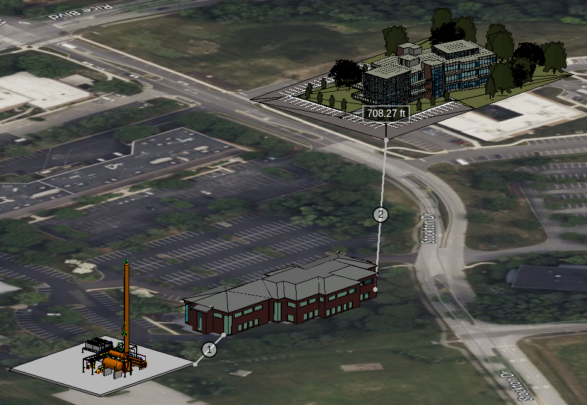

# Referencing Linked iModels

Linked iModels let a spatial view display multiple iModels together. This is useful when a site iModel provides the overall context and separate iModels describe buildings, plants, or other assets located at that site. The primary iModel establishes the view's coordinate system; each linked iModel is displayed through its own reference and transformed into that coordinate system.

Each iModel is represented by an [IModelDisplayReference]($frontend), which specifies the subset of its content to display, such as models, categories, and elements. References can be styled independently, with their own symbology overrides, view flags, and other display settings.


*Image showcases the measure distance tool being used to report the distance between a point in the primary reference and points in each linked imodel.*

## Scope and interaction

Links are managed directly by a spatial view's `iModelRefs` collection: use [SpatialIModelDisplayReferences.link]($frontend) to add a reference and [SpatialIModelDisplayReferences.unlink]($frontend) to remove it. Linked references do not contain their own links, so links are not nested. Drawing and sheet views are 2D and currently expose only their primary iModel reference.

```ts
const refs = viewport.iModelRefs;
if (!refs.isSpatial)
  throw new Error("Linked iModels require a spatial view");

const buildingRef = refs.link({ iModel: buildingIModel });
```

Displaying an iModel does not automatically make it available to every interaction tool. Picking linked content is opt-in through [LocateOptions.allowExternalIModels]($frontend), which is `false` by default. When enabled, handle the hit's [IModelDisplayFeature.iModelRef]($frontend), available from [HitDetail.feature]($frontend), rather than assuming it came from the primary iModel. Tools that do not opt in continue to operate on the primary iModel.

When enabled, a hit may come from an iModel other than the viewport's primary iModel, so don't assume its Ids belong to `viewport.iModel`:

- [HitDetail.iModel]($frontend) is the [IModelConnection]($frontend) to which the hit's element, model, and subcategory Ids belong.
- [HitDetail.isExternalIModelHit]($frontend) is `true` if that iModel is not the viewport's primary iModel.
- [HitDetail.feature]($frontend) identifies the specific [IModelDisplayReference]($frontend) that produced the hit, via [IModelDisplayFeature.iModelRef]($frontend).

For selection across linked iModels, applications can make [MultiIModelSelectionTool]($frontend) the default tool:

```ts
IModelApp.toolAdmin.defaultToolId = MultiIModelSelectionTool.toolId;
```

This tool opts in to linked-model hits and updates the selection set belonging to each hit's iModel.

## Links are runtime state

Linked-iModel support does not include persistence. Links are not part of the view definition: iTwin.js never stores which iModels a view links, nor the categories, models, or overrides displayed through each reference. They are not serialized with the view, and a view produced by `clone()` or loaded from a saved view does not carry them.

Composing a scene that includes linked iModels is therefore the application's responsibility: deciding which iModels to link, opening their [IModelConnection]($frontend)s, supplying each link's display state via [LinkSpatialIModelArgs]($frontend), and re-establishing the links whenever a new [ViewState]($frontend) is created - after loading a saved view, cloning a view, or switching views. An application that wants its linked-scene composition to survive sessions must record it in its own storage and replay it through [SpatialIModelDisplayReferences.link]($frontend).

This applies to viewport synchronization as well. [connectViewportViews]($frontend), [synchronizeViewportViews]($frontend), and [TwoWayViewportSync]($frontend) propagate changes by applying a *clone* of the changed viewport's view to the other viewports - via [Viewport.applyViewState]($frontend), which by design raises no change events - so each synchronization silently discards the target viewports' links. To synchronize viewports that display linked iModels, synchronize only their frusta using [connectViewportFrusta]($frontend) or [TwoWayViewportFrustumSync]($frontend), which never replace the views, or supply your own synchronization strategy to [connectViewports]($frontend) that re-establishes the links after applying the view.

For the same reason, APIs that describe the view definition's own content continue to report **only** the primary iModel. [ViewState.getTileTreeRefs]($frontend) and [Viewport.getTileTreeRefs]($frontend) iterate the tile trees of the view's models and display style; callers interpret the model and element ids of those trees against the view's own [ViewState.iModel]($frontend), and linked content is deliberately excluded so that assumption remains valid. To work with linked content, iterate `iModelRefs` instead - each [IModelDisplayReference]($frontend) exposes its own `tileTreeRefs`, and its ids belong to that reference's `iModel`:

```ts
for (const ref of viewport.iModelRefs) {
  for (const treeRef of ref.tileTreeRefs) {
    // ids obtained from treeRef belong to ref.iModel, which differs from viewport.iModel for linked references.
  }
}
```

Tile resource management - pruning, discarding expired tile trees, and memory statistics - accounts for linked iModels automatically; applications need not iterate linked tile trees for those purposes.

## Geolocation

An iModel's geolocation describes how its spatial coordinates relate to positions on Earth. Geolocation does not determine whether an iModel can be linked; it determines the transform iTwin.js can compute to place the linked iModel in the primary iModel's coordinate system.

### Non-geolocated

A non-geolocated iModel uses an arbitrary coordinate system with no defined relationship to the real world. It has no ECEF location, so iTwin.js cannot calculate where it belongs relative to a geolocated site. If either the primary or linked iModel has no ECEF location, the linked reference uses an identity transform. The coordinates are therefore treated as already being in the primary iModel's coordinate system; unrelated local coordinates will not automatically line up.

### Linear Geolocation

A geolocated iModel that has a linear transform from its spatial coordinates to Earth-Centered, Earth-Fixed (ECEF) coordinates. This is typical for buildings, plants, and campuses, where the project covers a limited area and a single translation and rotation are sufficient.

When both the primary and linked iModels have valid ECEF locations, iTwin.js composes their transforms to map the linked iModel into the primary iModel's coordinates. This lets a building iModel be positioned relative to a geolocated site iModel.

### Projected Geolocation

A geolocated iModel that has a non-linear map projection to relate its coordinates to Earth. Its ECEF location provides a linear approximation, but the full projected conversion is non-linear.

Linked iModels currently use the linear ECEF transforms; they do not perform the non-linear GCS reprojection when linking. The approximation is most useful near the iModel's ECEF reference location and becomes less accurate farther from it. As a result, geolocated iModels with different GCS definitions or large extents may not align precisely when linked.

### Placement limitations

- The placement is computed once, when the iModel is linked, and exposed as [IModelDisplayReference.linearTransformToParent]($frontend). Changing either iModel's ECEF location while it is linked (for example, through a briefcase transaction) is not supported; unlink and re-link the iModel to apply the new location.

For details on ECEF locations, GCS, and coordinate conversion, see [GeoLocation of iModels](./GeoLocation.md).
